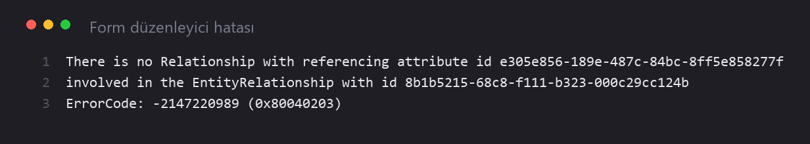
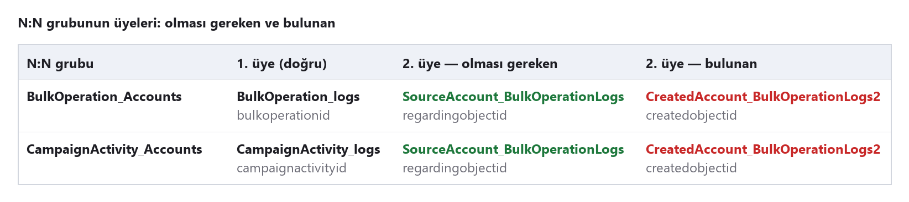

# Dynamics 365 9.1 On-Premise – "There is no Relationship with referencing attribute id" (subgrid) fix

> ⚠️ **UNSUPPORTED / DESTEKLENMEYEN YÖNTEM**
> Bu scriptler CRM metadata tablolarını (`MetadataSchema`) doğrudan SQL ile değiştirir. Bu yöntem **Microsoft tarafından desteklenmez**.
> These scripts modify CRM metadata tables directly. This is **not supported by Microsoft**.
> Önce tam veritabanı yedeği alın, test organizasyonunda deneyin ve mümkünse Microsoft desteğinde kayıt açın. Kullanım riski size aittir.
> Take a full database backup, test in a non-production org first, and preferably open a Microsoft support case. Use at your own risk.

## Belirti / Symptom

Form düzenleyicide Account (ve Contact / Lead) formuna subgrid eklerken:



```text
There is no Relationship with referencing attribute id e305e856-189e-487c-84bc-8ff5e858277f
involved in the EntityRelationship with id <guid>
ErrorCode: -2147220989 (0x80040203)
```

`e305e856-189e-487c-84bc-8ff5e858277f` = `BulkOperationLog.regardingobjectid` (sistem alanı, tüm organizasyonlarda aynı).

## Kök neden / Root cause

Quick Campaign ve Campaign Activity, hedef kayıtlarla N:N ilişkiyi `BulkOperationLog` üzerinden kurar
(`BulkOperation_Accounts/Contacts/Leads`, `CampaignActivity_Accounts/Contacts/Leads`).
Her N:N grup iki 1:N ilişkiden oluşmalı: `…_logs` (`bulkoperationid` / `campaignactivityid`) + `Source…_BulkOperationLogs` (`regardingobjectid`).

Organizasyon kurulumunda `msdynce_MarketingPatch` (9.0.1904.1019) katmanı bazı gruplara `Source…` yerine
`Created…_BulkOperationLogs` (`createdobjectid`) ilişkisini bağlıyor. Form düzenleyici `regardingobjectid` ilişkisini bulamadığı için hata veriyor.



The Marketing patch links the `Created…` relationship (`createdobjectid`) into these N:N groups instead of the
`Source…` relationship (`regardingobjectid`), so the form editor fails while enumerating Account relationships.

## Dosyalar / Files

| Dosya | Açıklama |
| --- | --- |
| `Diagnose_BulkOperationLog_NN.sql` | Salt okunur teşhis. Sağlam grup: `bulkoperationid`/`campaignactivityid` + `regardingobjectid`. Bozuk grup: `createdobjectid` içerir. |
| `BulkOperationLog_NN_Fix.sql` | Bozuk satırları bulur ve aynı tablonun `Source…` ilişkisiyle değiştirir. ID'leri kendisi bulur; her organizasyonda çalışır, tekrar çalıştırılabilir. |

## Kullanım / Usage

1. `<Org>_MSCRM` veritabanının **tam yedeğini** alın / take a full backup.
2. `Diagnose_BulkOperationLog_NN.sql` ile durumu görün / review the current state.
3. `BulkOperationLog_NN_Fix.sql` dosyasını `@Apply = 0` ile çalıştırın → yalnızca önizleme / preview only.
4. Önizleme doğruysa `@Apply = 1` → script yalnızca tüm kontroller geçerse kendisi `COMMIT` eder, aksi halde `ROLLBACK`.
5. Tüm CRM sunucularında `iisreset`; Asynchronous Processing, Async Maintenance ve Sandbox servislerini yeniden başlatın.
6. Account, Contact ve Lead formlarında subgrid eklemeyi deneyin.

Script güvenlik kontrolleri: 10 sn kilit sınırı (`SET LOCK_TIMEOUT`), tek ve kesin `Source` ilişkisi şartı,
mükerrer üyelik ve grup başına birden fazla bozuk satır kontrolü, işlem sonunda kalan bozuk satır kontrolü.

## Tuzaklar / Pitfalls

- Metadata satırları katmanlıdır; canlı sürüm `OverwriteTime = '1900-01-01'`.
- Açık kalan transaction satırları kilitler ve değişiklik CRM'e görünmez. Kilidi `sys.dm_tran_locks` ile bulun.
- Form düzenleyici ilk bozuk grupta durur; bir grubu düzeltince hata sonrakine kayar. Tüm grupları birlikte düzeltin.
- CRM metadata'yı bellekte tutar: `iisreset` + Async servis yeniden başlatma şart.
- Düzeltme managed bir katmanda; Marketing yaması yeniden kurulursa sorun geri gelebilir. Her güncellemeden sonra teşhis sorgusunu çalıştırın.

## Ortam / Tested on

Dynamics 365 Customer Engagement 9.1 On-Premise (9.1.47.x), SQL Server. İki farklı organizasyonda test edildi.

## Lisans / License

MIT – Kullanım riski size aittir / provided "as is", without warranty of any kind.
